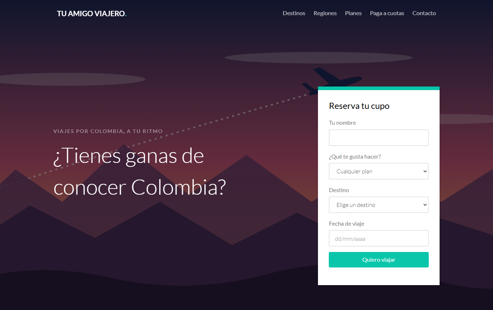
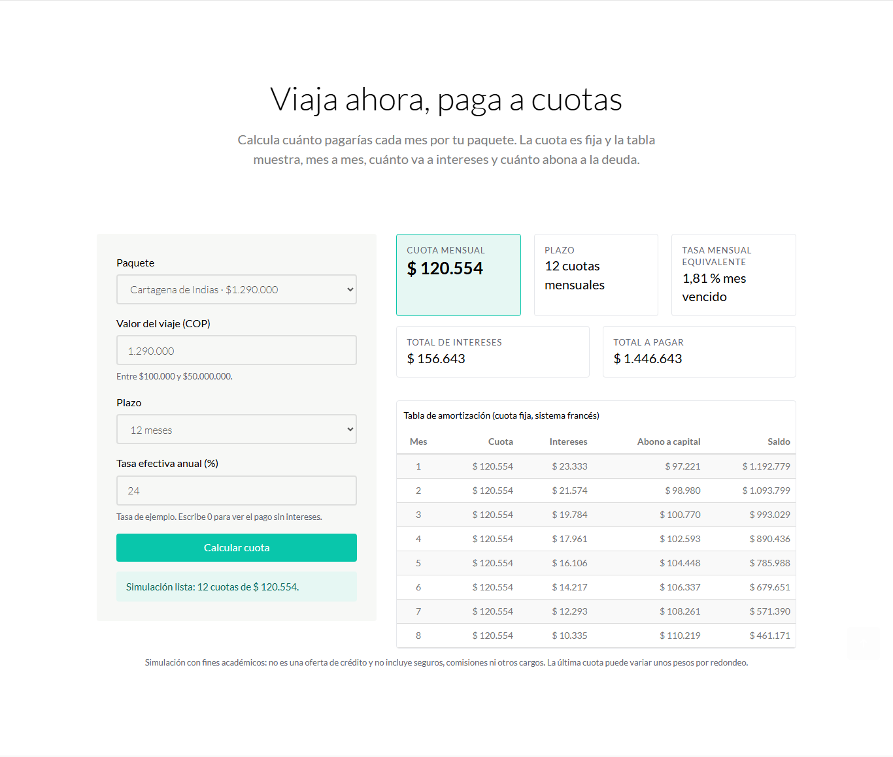
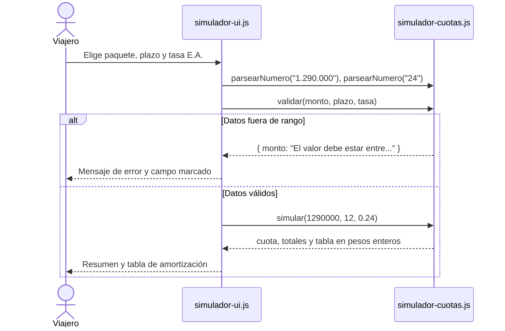
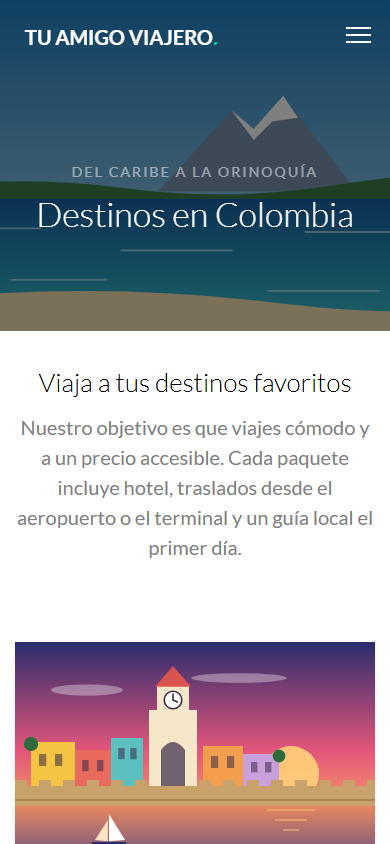

<div align="center">

# Tu Amigo Viajero

**Sitio de una agencia de viajes ficticia por Colombia, con simulador para pagar el viaje a
cuotas. Proyecto académico en equipo (2022), revisado en 2026.**

[](https://github.com/DarwinMontiel/tu-amigo-viajero/actions/workflows/ci.yml)
[](https://darwinmontiel.github.io/tu-amigo-viajero/)


[**Ver el sitio**](https://darwinmontiel.github.io/tu-amigo-viajero/) ·
[**Probar el simulador**](https://darwinmontiel.github.io/tu-amigo-viajero/pricing.html#simulador)



</div>

## De qué se trata

*Tu Amigo Viajero* es una agencia que no existe. Vende paquetes a seis destinos colombianos
(Cartagena, Caño Cristales, Salento, Guatapé, San Andrés y Villa de Leyva), ofrece planes
mensuales en pesos y deja simular el pago del viaje a cuotas antes de decidir. La portada
cuenta el proceso con una clienta ficticia: doña Gloria, pensionada de Bogotá que quería
conocer el mar.

| Página | Contenido |
|---|---|
| [`index.html`](index.html) | Portada con formulario de reserva (fecha en español), destinos populares, "Cómo funciona", historias de viajeros y cifras |
| [`destination.html`](destination.html) | Seis destinos con región, duración, temporada recomendada, precio desde y galería ampliable |
| [`pricing.html`](pricing.html) | Planes Básico, Familiar y Plus en COP por mes, **simulador "Viaja ahora, paga a cuotas"** y preguntas frecuentes |
| [`contact.html`](contact.html) | Formulario de contacto e información de la agencia |

Todo es ficticio y está dicho en el propio sitio: precios, cifras, testimonios, teléfono y
correo. Los formularios validan en el navegador y muestran un mensaje claro, pero no envían
ni guardan datos.

## Simulador "Viaja ahora, paga a cuotas"



Con el valor del paquete, el plazo y una tasa efectiva anual (E.A.), calcula una **cuota fija
mensual (sistema francés)** y la tabla de amortización mes a mes: cuota, intereses, abono a
capital y saldo.

- Convierte la tasa E.A. en mensual equivalente: `i = (1 + EA)^(1/12) − 1`.
- Cuota: `C = P · i / (1 − (1 + i)^−n)`; con tasa 0 es simplemente `P / n`.
- Trabaja en **pesos enteros** y la última cuota absorbe la diferencia de redondeo, así que el
  saldo cierra exactamente en $0 y los abonos suman el valor del viaje.
- Entiende cómo se escriben los números en Colombia (`1.290.000`, `24,5`) y responde con
  mensajes de error en español cuando el valor, el plazo o la tasa están fuera de rango.



La lógica (`js/simulador-cuotas.js`) es JavaScript puro, sin dependencias ni acceso al DOM:
funciona en el navegador y se prueba con `node --test`. La interfaz (`js/simulador-ui.js`)
solo lee el formulario y pinta los estados vacío, error y resultado.

## Qué demuestra y cómo se relaciona con mi experiencia

Es el proyecto más antiguo de mi portafolio y el más centrado en frontend. Lo conservo porque
muestra de dónde vengo y porque, al revisarlo, le agregué algo de mi trabajo actual.

- **Cálculo de cuotas como en cartera.** Trabajo en automatización y backend para el sector de
  cartera y cobranzas, donde una cuota mal redondeada o un saldo que no cierra en cero es un
  error real. El simulador aplica esas mismas reglas: pesos enteros, ajuste en la última
  cuota y pruebas que verifican que todo cuadre.
- **Lógica separada de la interfaz.** Las reglas viven en módulos puros con pruebas; el DOM
  queda en una capa delgada.
- **Calidad automatizada aun en un sitio estático.** La integración continua valida el HTML,
  revisa enlaces y anclas, textos alternativos, etiquetas Open Graph, imágenes sin uso y que
  `css/style.css` esté compilado desde Sass.
- **Cuidado con las licencias.** Se conserva la atribución CC BY 3.0 de la plantilla y se
  reemplazaron las fotos sin fuente por ilustraciones propias ([AVISOS.md](AVISOS.md)).

Mis proyectos de backend y RPA están en
[colmena-rpa](https://github.com/DarwinMontiel/colmena-rpa) (bots con colas RabbitMQ),
[radar-cartera](https://github.com/DarwinMontiel/radar-cartera) (ETL y calidad de datos de
cartera) y [faro-cobranza](https://github.com/DarwinMontiel/faro-cobranza) (CRM de cobranza).

## Proyecto académico en equipo

Lo hicimos en 2022 **Darwin Montiel, Andrés, Jhon y Martín** como proyecto de la carrera
de Ingeniería de Sistemas. Partimos de una plantilla gratuita de
[GetTemplates.co](https://gettemplates.co/) (licencia
[CC BY 3.0](https://creativecommons.org/licenses/by/3.0/deed.es)) y la adaptamos con páginas,
formularios y contenido propios de la agencia.

**Qué aporté.** En 2022 trabajé con el equipo en la adaptación de las páginas, los formularios
y los textos; no conservamos el detalle de quién hizo cada parte, así que no lo atribuyo por
persona. En 2026 hice solo la revisión que se ve hoy:

- Reescribí todo el contenido en español: agencia colombiana, destinos nacionales, precios en
  COP y "/mes", sin texto de relleno ni restos en inglés de la plantilla.
- Reemplacé las fotos sin fuente conocida por ilustraciones SVG de destinos y fondos creadas
  para este repositorio.
- Programé el simulador de cuotas, la validación de formularios con mensajes en español y el
  selector de fechas en español (dd/mm/aaaa).
- Agregué accesibilidad básica (textos alternativos, enlace para saltar al contenido, etiquetas
  ARIA), Open Graph para compartir enlaces, pruebas, validación de HTML e integración continua.
- Quité scripts, estilos e imágenes de la plantilla que no se usaban.

El historial completo está en el [CHANGELOG](CHANGELOG.md).

## Tecnologías

- **HTML5** y **CSS3** compilado desde **Sass** (`sass/style.scss` + `sass/_tu-amigo.scss`).
- **Bootstrap 3** (grilla responsive) y **jQuery** con Waypoints (animaciones al hacer
  scroll), Stellar (parallax), Magnific Popup (galería) y Bootstrap Datepicker.
- **JavaScript** sin dependencias para el simulador y los formularios.
- **Node.js 24** solo para desarrollo: `node --test`, html-validate y Sass.



## Ejecutar localmente

No requiere instalación: abre `index.html` en el navegador o sirve la carpeta.

```bash
python -m http.server 8000      # http://localhost:8000
```

Para desarrollar (Node.js 20 o superior):

```bash
npm ci               # Sass y html-validate, versiones fijas
npm run estilos      # compila sass/ en css/style.css
npm run check        # valida HTML, revisa el sitio y corre las pruebas
```

| Comando | Qué hace |
|---|---|
| `npm run lint:html` | Valida las 4 páginas con html-validate |
| `npm run verificar` | Revisa enlaces y anclas, textos alternativos, Open Graph, atribución e imágenes sin uso |
| `npm test` | Pruebas del simulador, de los formularios y del verificador |
| `npm run estilos:vigilar` | Recompila los estilos al guardar |

## Estructura

```
├── index.html, destination.html, pricing.html, contact.html
├── sass/                 estilos fuente (plantilla + _tu-amigo.scss)
├── css/                  estilos compilados y de librerías
├── js/
│   ├── simulador-cuotas.js   lógica pura del simulador (probada)
│   ├── simulador-ui.js       estados del simulador en la página
│   ├── formularios.js        validación y mensajes de los formularios (probada)
│   └── main.js               menú, animaciones, contadores y fechas
├── images/               ilustraciones SVG propias
├── scripts/verificar-sitio.mjs
├── tests/                pruebas con node --test
└── docs/                 capturas del README y vista previa para redes
```

## Licencia y créditos

Código y contenido propios bajo [licencia MIT](LICENSE). Diseño base: plantilla gratuita de
[GetTemplates.co](https://gettemplates.co/) bajo CC BY 3.0, con atribución en el pie de cada
página. Las licencias de cada librería están en [AVISOS.md](AVISOS.md).
