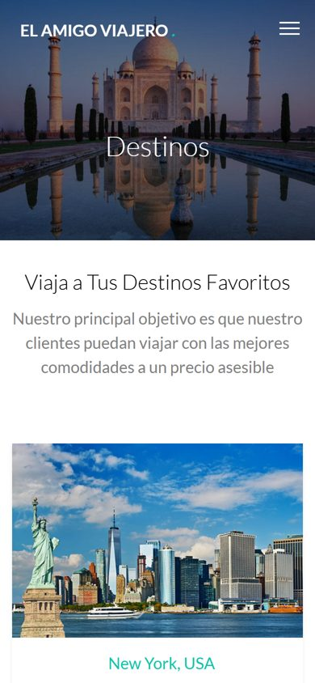

<div align="center">

# Tu Amigo Viajero

**Sitio web estático para una agencia de viajes: página de inicio con formulario de registro,
destinos, planes y precios, y contacto.**

[](https://darwinmontiel.github.io/tu-amigo-viajero/)


[**Ver sitio**](https://darwinmontiel.github.io/tu-amigo-viajero/)


</div>

## Sobre el proyecto

Proyecto académico de desarrollo web (2022) realizado en equipo por **Darwin Montiel, Andrés,
Jhon y Martín**. Partimos de una plantilla gratuita de
[GetTemplates.co](https://gettemplates.co/) (licencia
[CC BY 3.0](https://creativecommons.org/licenses/by/3.0/)) y la adaptamos con contenido,
imágenes, textos en español, formularios y páginas propias de la agencia.

| Página | Contenido |
|---|---|
| `index.html` | Portada con formulario de registro (actividades, destino, fecha), destinos destacados y testimonios |
| `destination.html` | Catálogo de destinos con galería (Magnific Popup) |
| `pricing.html` | Planes y precios |
| `contact.html` | Formulario de contacto e información de la agencia |

## Tecnologías

- **HTML5** semántico y **CSS3** compilado desde **Sass** (`sass/style.scss`).
- **Bootstrap 3** (grid responsive) y **jQuery** con plugins: Owl Carousel, Waypoints (animaciones
  al hacer scroll), Stellar (parallax), Magnific Popup y Bootstrap Datepicker.
- Diseño responsive: se adapta a celular, tableta y escritorio.



## Ejecutar localmente

No requiere instalación: abrir `index.html` en el navegador o servir la carpeta:

```bash
python -m http.server 8000      # http://localhost:8000
```

Para modificar estilos: `sass --watch sass/style.scss:css/style.css`.

## Lo que aprendí

- Estructurar un sitio de varias páginas con un sistema de grillas responsive.
- Organizar estilos con Sass (variables, *partials* y *mixins*) y compilarlos a CSS.
- Integrar plugins de jQuery para carruseles, galerías y animaciones al hacer scroll.
- Trabajar en equipo con Git sobre un mismo código base.

## Créditos

Diseño base: plantilla gratuita de [GetTemplates.co](https://gettemplates.co/), usada bajo
licencia CC BY 3.0 (atribución incluida en el pie de cada página). Imágenes de demostración
con fines académicos.
