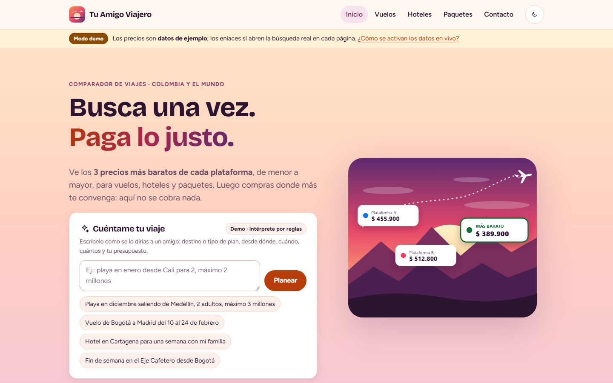
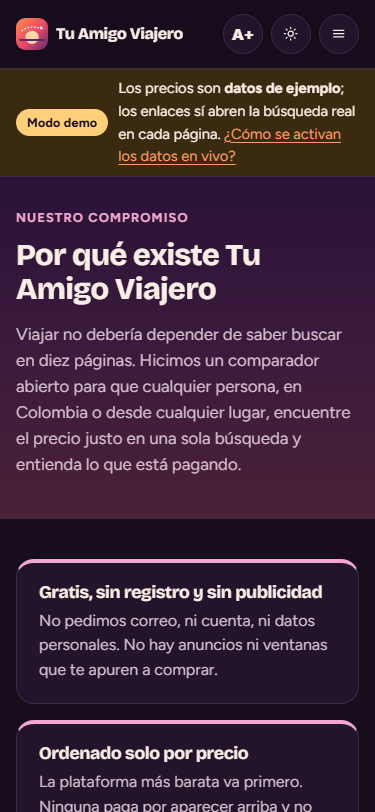
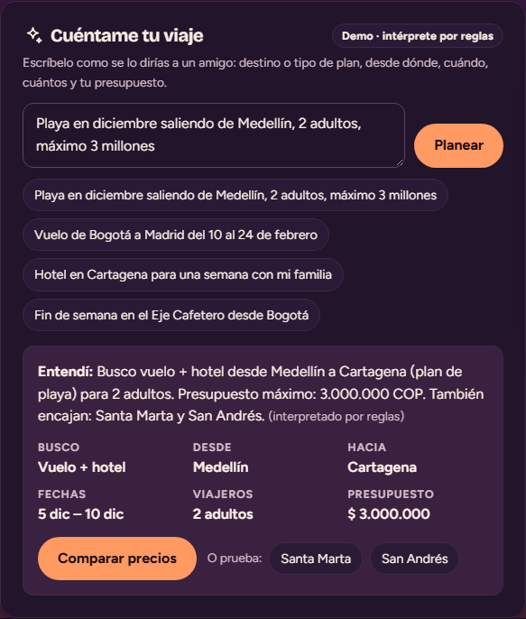
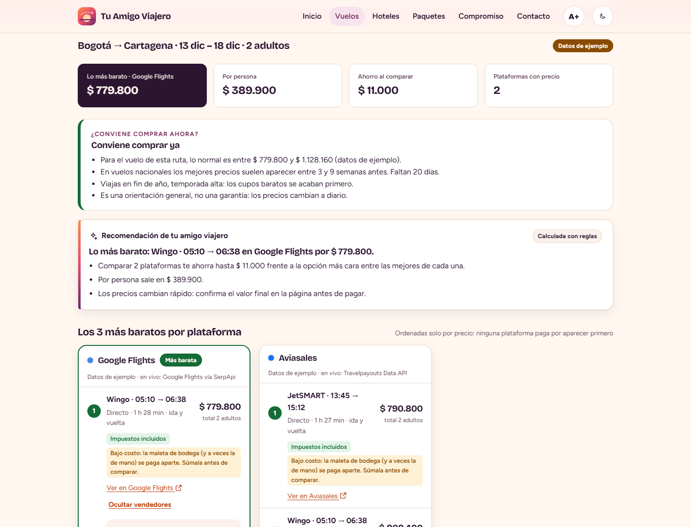
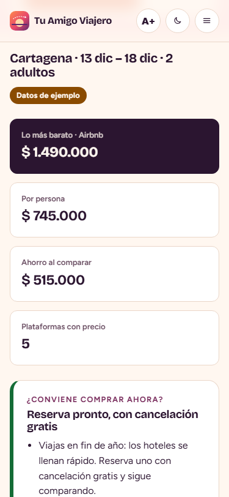
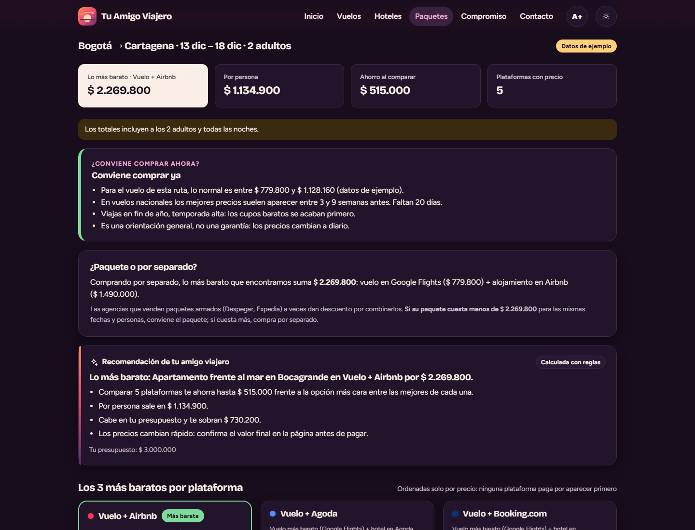
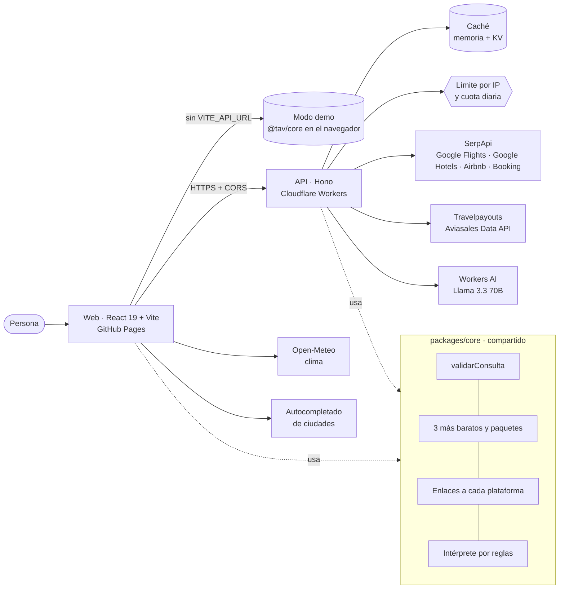
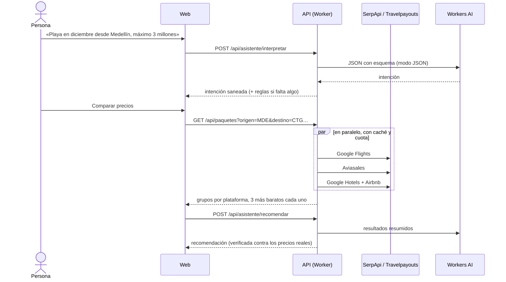

<div align="center">

# Tu Amigo Viajero

**Comparador de precios de viaje para Colombia y el exterior: una búsqueda, los 3 precios más
baratos de cada plataforma, de menor a mayor, para vuelos, hoteles y paquetes. Con un asistente de
viaje con IA gratuita. Aquí no se paga nada: cada precio lleva a la plataforma para comprar.**

[](https://github.com/DarwinMontiel/tu-amigo-viajero/actions/workflows/ci.yml)
[](https://github.com/DarwinMontiel/tu-amigo-viajero/actions/workflows/pages.yml)


[**Abrir el comparador**](https://darwinmontiel.github.io/tu-amigo-viajero/) ·
[Vuelos](https://darwinmontiel.github.io/tu-amigo-viajero/vuelos) ·
[Hoteles](https://darwinmontiel.github.io/tu-amigo-viajero/hoteles) ·
[Paquetes](https://darwinmontiel.github.io/tu-amigo-viajero/paquetes)



</div>

## Nuestro compromiso

Viajar no debería depender de saber buscar en diez páginas. Tu Amigo Viajero es un **servicio
abierto para la comunidad**: cualquier persona, en Colombia o desde cualquier lugar, encuentra el
precio justo en una sola búsqueda y entiende lo que está pagando.

- **Gratis, sin registro y sin publicidad.** No pedimos datos personales ni usamos cookies de seguimiento.
- **Ordenado solo por precio.** Ninguna plataforma paga por aparecer primero y no escondemos ninguna.
- **Transparente.** Cada precio dice de dónde sale, cuándo se consultó, si es en vivo o de ejemplo,
  si trae impuestos y si la maleta se paga aparte.
- **Afiliados declarados.** Hoy ningún enlace es de afiliado. Si algún día lo es, la tarjeta lo dice
  y la comisión no cambia el precio ni el orden.
- **Te ayudamos a decidir, no a gastar:** si conviene comprar ya o esperar, cuánto ahorras al
  comparar, si un paquete conviene más que comprar por separado y la tasa del día.
- **Para todas las personas y todos los celulares:** accesibilidad WCAG 2.2 AA, letra grande y modo
  para ahorrar datos en conexiones lentas.



La página [/compromiso](https://darwinmontiel.github.io/tu-amigo-viajero/compromiso) lo explica en
el sitio y el [ADR 0006](docs/adr/0006-servicio-para-la-comunidad.md) cuenta cómo está implementado.

<br clear="right">

## Qué es

Comparar un viaje obliga a abrir cinco páginas y escribir lo mismo en cada una. Tu Amigo Viajero lo
hace en una sola búsqueda:

- **Vuelos:** los 3 más baratos de **Google Flights** y de **Aviasales**, y la búsqueda ya armada en
  **Despegar, Kayak y Skyscanner**. En cada vuelo, «¿Dónde lo compro más barato?» muestra qué
  vendedor lo ofrece más barato: la aerolínea, Despegar, Expedia, Kiwi y otros.
- **Hoteles:** los 3 más baratos de **Booking.com, Expedia, Agoda, Hotels.com, Trip.com, Airbnb** y
  cualquier otra agencia que aparezca en Google Hotels, con el total de la estadía y el precio por noche.
- **Paquetes:** el vuelo más barato sumado a los 3 hoteles más baratos de cada plataforma, con el
  desglose, más los paquetes armados de Despegar y Expedia.
- **Inicio:** las ofertas más baratas que otros viajeros encontraron en los portales, nacionales e
  internacionales, desde Bogotá, Medellín o Cali, con el filtro **«¿A dónde voy con mi presupuesto?»**.
- **Asistente con IA:** escribe «playa en diciembre saliendo de Medellín, 2 adultos, máximo 3
  millones». El asistente arma la búsqueda, muestra lo que entendió antes de buscar y, con los
  resultados, da una recomendación que **no puede inventar precios**.
- **¿Conviene comprar ahora?** Una orientación clara según la anticipación, las temporadas altas de
  Colombia y, con datos en vivo, si Google Flights ve el precio bajo, normal o alto para la ruta.
- **Total real:** marca si el precio trae impuestos (y los suma cuando la fuente los da aparte) y
  avisa cuando una aerolínea de bajo costo cobra la maleta aparte.
- **¿Paquete o por separado?** Te da el total por separado como umbral para comparar paquetes armados.
- **Tasa del día** con la equivalencia en dólares o pesos (ExchangeRate-API).
- **Clima del destino** para tus fechas, con Open-Meteo.
- **Letra grande y ahorro de datos**, que se activa solo en conexiones lentas.

Todo es legal y gratis: APIs oficiales o de terceros que lo permiten, **sin raspar páginas**, con
planes gratuitos protegidos con caché y cuota diaria.

| Asistente (tema oscuro) | Vuelos con vendedores | Celular (375 px) |
|---|---|---|
|  |  |  |



## Arquitectura





| Paquete | Responsabilidad |
|---|---|
| [`packages/core`](packages/core/src) | Dominio puro y probado: validación, enlaces, ranking, paquetes, intérprete en español y datos de ejemplo |
| [`apps/api`](apps/api/src) | Proveedores, caché, límites, cuota diaria, IA y rutas HTTP |
| [`apps/web`](apps/web/src) | Interfaz React accesible, temas claro y oscuro, cliente de la API o del modo demo |

### API

| Ruta | Qué hace | Costo en SerpApi |
|---|---|---|
| `GET /api/vuelos?origen=BOG&destino=CTG&ida=…&regreso=…&adultos=2&moneda=COP` | 3 más baratos por plataforma | 1 |
| `GET /api/hoteles?destino=CTG&ida=…&regreso=…` | Agrupa Google Hotels por agencia + Airbnb | 2 |
| `GET /api/paquetes?…` | Vuelo más barato + 3 hoteles por plataforma | 3 (reusa la caché) |
| `GET /api/vuelos/opciones?token=…&…` | Vendedores de un vuelo | 1–2, bajo demanda |
| `GET /api/hoteles/ir?token=…&fuente=Expedia&…` | Redirige al enlace exacto de esa agencia | 1, solo al hacer clic |
| `GET /api/ofertas?origen=BOG` | Ofertas destacadas (Aviasales) | 0 |
| `POST /api/asistente/interpretar` · `POST /api/asistente/recomendar` | Asistente con IA | 0 |
| `GET /api/salud` | Modo y fuentes configuradas | 0 |

## Cómo correrlo

Requisitos: Node.js 22.22 o superior (el CI usa 24).

### Sin claves (modo demo)

```bash
npm ci
npm run dev          # http://localhost:5173
```

La web usa los datos de ejemplo dentro del navegador. Todo funciona, incluido el asistente por
reglas, y los enlaces abren las búsquedas reales. Hay datos de ejemplo para 10 rutas, como
Bogotá → Cartagena, Medellín → San Andrés, Bogotá → Miami y Bogotá → Madrid, y para 7 ciudades de
hoteles. Cualquier otra ruta muestra los enlaces a las plataformas.

### Con claves (datos en vivo)

```bash
cp apps/api/.dev.vars.example apps/api/.dev.vars   # pega SERPAPI_KEY y TRAVELPAYOUTS_TOKEN
npm run dev:api                                     # API en http://localhost:8787
VITE_API_URL=http://localhost:8787 npm run dev      # web contra la API local
```

`.dev.vars` está en `.gitignore`. Workers AI usa tu cuenta de Cloudflare también en local
(`npx wrangler login`).

### Calidad

| Comando | Qué hace |
|---|---|
| `npm run lint` | ESLint con TypeScript, React Hooks y `jsx-a11y` |
| `npm run typecheck` | `tsc -b` de los tres paquetes, en modo estricto |
| `npm test` | 104 pruebas unitarias con Vitest: dominio, proveedores con respuestas de muestra, API, caché, cuota, límites e IA |
| `npm run e2e` | 21 escenarios e2e con Playwright, cada uno a 1440 y 375 px, con **axe-core** en tema claro y oscuro |
| `npx playwright test --config scripts/capturas.config.ts` | Regenera las capturas de `docs/` |

## Claves que debes crear (todas gratis)

| # | Servicio | Para qué | Dónde se obtiene |
|---|---|---|---|
| 1 | **SerpApi** | Google Flights, Google Hotels y Airbnb | [serpapi.com/users/sign_up](https://serpapi.com/users/sign_up) → plan **Free** (250 búsquedas al mes) → *Dashboard* → **Your Private API Key** |
| 2 | **Travelpayouts** | Vuelos y ofertas de Aviasales | [travelpayouts.com](https://www.travelpayouts.com/) → crear cuenta → *Programs* → unirse a **Aviasales** → *Profile* → **API token**. El *Partner ID* es el marcador opcional |
| 3 | **Cloudflare** | Alojar la API e IA gratuita | [dash.cloudflare.com/sign-up](https://dash.cloudflare.com/sign-up) (plan Free). Workers AI no necesita otra clave |
| 4 | *(opcional)* Token de Cloudflare para GitHub Actions | Desplegar la API con cada push | *My Profile* → *API Tokens* → plantilla **Edit Cloudflare Workers**; y el **Account ID** de la página de Workers |

### Activar los datos en vivo en un solo comando

Con las claves 1 y 2 a mano y una cuenta gratuita de Cloudflare:

```bash
npm ci
npm run activar
```

El asistente hace esto:

1. Inicia sesión en Cloudflare.
2. Crea el KV de caché y cuota.
3. Pide las claves, revisa que estén bien pegadas y las guarda como secretos del Worker.
4. Despliega la API y comprueba `/api/salud`.
5. Si tienes `gh`, conecta la web con la API (variable `API_URL`) y la vuelve a publicar.

Al terminar, el sitio deja el modo demo y muestra precios en vivo. Solo queda hacer commit del
`wrangler.toml` con el id del KV, que no es secreto.

### Despliegue paso a paso (alternativa manual)

1. **API** (una vez, desde tu equipo):

   ```bash
   cd apps/api
   npx wrangler login
   npx wrangler secret put SERPAPI_KEY
   npx wrangler secret put TRAVELPAYOUTS_TOKEN
   npx wrangler secret put TRAVELPAYOUTS_MARKER     # opcional
   npx wrangler deploy                              # imprime https://tu-amigo-viajero-api.<tu-subdominio>.workers.dev
   ```

   Opcional, para compartir la caché entre instancias: `npx wrangler kv namespace create CACHE` y
   descomenta el bloque `[[kv_namespaces]]` de [`wrangler.toml`](apps/api/wrangler.toml).

2. **Web:** en GitHub, *Settings → Secrets and variables → Actions → Variables*, crea `API_URL` con la
   URL del paso 1 y vuelve a ejecutar **Publicar en GitHub Pages**. Sin esa variable el sitio queda en
   modo demo.

3. *(Opcional)* Guarda `CLOUDFLARE_API_TOKEN` y `CLOUDFLARE_ACCOUNT_ID` como *secrets* del repositorio:
   el flujo [`api.yml`](.github/workflows/api.yml) despliega la API con cada cambio. Sin el token, ese
   flujo no hace nada.

**Costo total: $0.** Si se agota alguna cuota gratuita, la plataforma afectada lo dice y el resto de
la página sigue funcionando: no hay cobros sorpresa.

## Decisiones técnicas (ADR)

1. [Monorepo TypeScript con modo demo de primera clase](docs/adr/0001-monorepo-y-modo-demo.md)
2. [Fuentes de precios: SerpApi + Travelpayouts, sin scraping](docs/adr/0002-fuentes-de-precios.md). Incluye por qué no se usan Amadeus (cerrado en julio de 2026), Duffel ni las APIs de afiliados
3. [Backend en Cloudflare Workers con Hono](docs/adr/0003-backend-en-cloudflare-workers.md)
4. [Asistente con IA gratuita (Workers AI) y respaldo por reglas](docs/adr/0004-asistente-con-ia-gratuita.md)
5. [Identidad visual «atardecer en vuelo» y accesibilidad AA](docs/adr/0005-identidad-visual-y-accesibilidad.md)
6. [Un servicio público para la comunidad](docs/adr/0006-servicio-para-la-comunidad.md)

## Limitaciones conocidas

- **Cuota gratuita:** SerpApi da 250 búsquedas al mes, y la API se limita a 8 por día
  (`SERPAPI_LIMITE_DIARIO`). Ojo: son búsquedas de SerpApi, no de personas. Un paquete gasta 3 y
  un «¿Dónde lo compro?» de ida y vuelta gasta 2. Las búsquedas repetidas salen de la caché.
  - En producción conviene crear el KV `CACHE` para que la cuota y la caché se compartan entre
    instancias.
  - Subir el tope es cambiar una variable.
- **Aviasales** muestra precios que otros viajeros vieron en las últimas 48 horas: pueden cambiar
  al abrir la página.
- **Despegar, Kayak y Skyscanner** no tienen API pública de precios: aparecen como «Solo enlace».
- **Google Hotels** no acepta fechas por URL: el respaldo de los enlaces abre el hotel y ahí se
  eligen las fechas. Con la API, el enlace exacto de cada agencia sí lleva las fechas.
- Los precios de hoteles son por habitación según cada agencia; impuestos y tasas pueden variar.
- El **modo demo** tiene datos de ejemplo para 10 rutas y 7 ciudades. Son ilustrativos, no reales.
- La IA (Llama 3.3) puede entender mal un pedido raro: por eso muestra lo que entendió antes de buscar.
- **¿Conviene comprar ahora?** es una orientación basada en reglas generales y, en vivo, en el
  indicador de Google Flights. No predice precios.
- **Equipaje:** el aviso se basa en el tipo de aerolínea. Las fuentes no siempre informan la tarifa
  exacta de la maleta.
- Todavía no hay alertas de precio por correo: exigirían guardar datos personales, y hoy el
  compromiso es no pedir ninguno. Para volver a revisar, se guarda o comparte el enlace.

## Estructura

```
├── packages/core/          dominio compartido (+ test/)
│   └── src/demo/           datos de ejemplo y generador del modo demo
├── apps/api/               Worker: index.ts (rutas), servicio.ts, ia.ts, cache.ts, limites.ts
│   └── src/proveedores/    serpapi.ts, travelpayouts.ts
├── apps/web/               React: paginas/, componentes/, api.ts, estilos.css
├── e2e/                    Playwright + axe-core
├── scripts/                capturas reproducibles
└── docs/                   capturas y adr/
```

## Historia y créditos

Tu Amigo Viajero nació en 2022 como **proyecto académico en equipo** de Ingeniería de Sistemas,
hecho por **Darwin Montiel, Andrés, Jhon y Martín**: una agencia de viajes ficticia sobre una
plantilla gratuita de GetTemplates. No conservamos el detalle de quién hizo cada parte, así que no
lo atribuyo por persona.

En 2026 lo revisé (versiones 2.x: simulador de cuotas, buscador con enlaces) y luego lo
**reconstruí desde cero como comparador real** (3.0): arquitectura, API, IA, diseño, pruebas y
documentación. De la versión original quedan el nombre, la idea y las ilustraciones de destinos
creadas para este repositorio. Detalle en el [CHANGELOG](CHANGELOG.md) y en [AVISOS.md](AVISOS.md).

**Autor de la versión 3.0:** Darwin Montiel ·
[LinkedIn](https://www.linkedin.com/in/darwin-montiel-mora-925216206) ·
[GitHub](https://github.com/DarwinMontiel)

## Licencia

Código bajo [licencia MIT](LICENSE). Licencias de terceros en [AVISOS.md](AVISOS.md). Las marcas
citadas pertenecen a sus dueños; este proyecto no está afiliado a ninguna de ellas.
